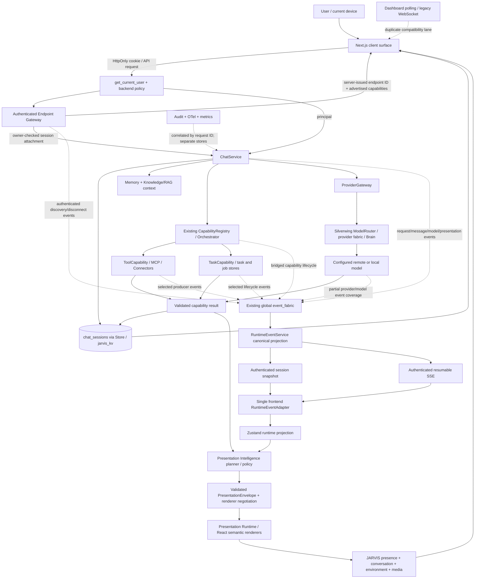

# JARVIS Runtime Dependency Graph

This graph depicts current ownership and integration boundaries, not an assertion that every optional provider is configured. Solid arrows are verified primary execution/data direction. Dotted/labelled connections are partial or still requiring integration.

## Runtime flow



## Data and command loop

```text
USER INPUT
  → authenticated command/request
  → ChatService (conversation authority, idempotency, context)
  → backend authorization
  → existing capability/tool/provider execution authority
  → real result or structured failure
  → global event fabric
  → canonical event projection + sequence/snapshot
  → Presentation Intelligence (evidence + supported renderers)
  → Presentation Runtime (semantic React renderer)
  → user interaction
  → a new backend command (never direct privileged execution from presentation)
```

`RuntimeEvent` and `PresentationEvent` are informational state/evidence. Neither is a permission token. UI interactions must re-enter backend authentication, resource ownership, policy and capability checks.

## Current ownership map

| Responsibility | Existing authority | What downstream layers receive |
|---|---|---|
| Identity and sessions | `core.py`, `routers/auth.py`, auth stores | Authenticated principal and verified session |
| Authorization | Backend route, owner, role, tenant and capability policies | Allow/deny or scoped command context |
| Conversation/messages | `ChatService` + `chat_sessions` | Ordered persisted messages and request correlation |
| AI routing/execution | `ProviderGateway` + Silverwing `ModelRouter` / configured provider | Normalized answer, model/provider metadata and failures |
| Capabilities/tools | Existing `CapabilityRegistry` + `Orchestrator` | `ExecutionResult`, execution lifecycle and artifacts |
| Memory/knowledge | Existing memory and RAG services | Minimum relevant context/evidence, never frontend-owned records |
| Tasks/jobs | Existing task/job subsystem per route | Real task state only when owner emits it |
| Runtime truth | Global `event_fabric` + `RuntimeEventService` projection | Scoped sequence, state and replayable semantic event |
| Presentation decision | PIL planner/policy and renderer negotiation | Validated semantic intent, constrained by evidence/support |
| Presentation rendering | Frontend adapter/store/React renderer | Device-specific rendering, not authority |
| Audit/telemetry | Existing audit, metrics, traces | Correlation and approved metadata, excluding sensitive content |

## Trust boundaries and current caveats

- Browser authentication uses platform-managed HttpOnly cookies; session ownership is rechecked on runtime snapshot/SSE routes.
- `CapabilityRegistry.event_bus` remains a local producer bus. A lifecycle bridge forwards selected execution events to the global event fabric; it is not a second replay authority and should not grow into another one.
- The canonical runtime journal is currently process-local. Replay across process restart/multiple workers is not guaranteed.
- Chat transcript streaming and runtime SSE are separate semantic channels. The first delivers message content; the latter describes runtime transitions. They share the canonical request identity when originating from the chat request.
- Runtime event payloads must remain allowlisted and sensitivity-classified. No secrets, raw private messages, full prompts, or unapproved media contents belong in ordinary events.
- Location, maps, voice, image, vision, tasks, browser and device nodes in the graph denote existing modules or integration points; live end-to-end wiring is not implied. Refer to [`JARVIS_INTEGRATION_MATRIX.md`](JARVIS_INTEGRATION_MATRIX.md) for configured/available status and tests.

## Migration order

1. Close authorization gaps at backend boundaries.
2. Propagate request identity and publish real provider/capability/task/voice/media/browser events from existing owners.
3. Prove authenticated snapshot/SSE sequencing, replay, disconnect and ownership.
4. Feed only real canonical events/results into Presentation Intelligence.
5. Implement and register real semantic renderers one vertical slice at a time.
6. Retire legacy polling/WebSocket presentation lanes only after dependent consumers migrate.
